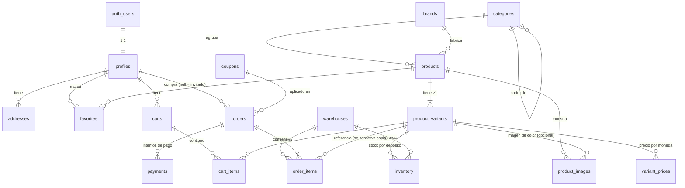

# Diseño de base de datos — Fase 2A

> **Estado: aprobado (versión 3, 27/09/2026).** Migración preparada en
> [`supabase/migrations/0001_esquema_inicial.sql`](../../supabase/migrations/0001_esquema_inicial.sql).
> **Todavía no se aplicó** a ningún proyecto de Supabase.

## Principios

- **Un producto existe una sola vez.** Se vende en Argentina y/o Brasil según tenga precio en ARS y/o BRL.
  No hay productos duplicados por país.
- **La variante es la unidad vendible**: tiene el SKU, el precio y el stock. Todo producto tiene al menos una
  (un accesorio sin opciones tiene una variante única).
- **Stock por depósito**: cada variante tiene stock independiente en cada depósito (AR, BR y los que se agreguen).
- **El cliente nunca ve cantidades**: solo "En stock", "Últimas unidades" o "Sin stock".
- **Checkout como invitado**: el pedido guarda todos los datos del cliente y no necesita un `profile`.
- **Dinero en `bigint` de unidades menores** (`*_minor`, centavos). Coincide con el tipo `Money` del frontend y
  evita errores de redondeo. Mercado Pago recibe `amount_minor / 100`.
- **El pedido es una foto inmutable**: copia precios, nombres, SKU y dirección del momento de la compra.
- **RLS en todas las tablas.** El frontend con la anon key solo puede leer el catálogo publicado y los datos
  propios del usuario. Pedidos y pagos los escribe únicamente la `service_role` (servidor/Edge Functions).
- **Textos en español + columna `*_pt_br` opcional**: si falta la traducción se muestra el español
  (igual que los diccionarios de `src/i18n`).

## 1. Diagrama



17 tablas: las 14 pedidas más tres que hacen falta:

- **`brands`**: la home ya navega por marca; como texto libre se duplicaría "Nike"/"nike".
- **`variant_prices`**: un precio por variante y moneda (sección 7).
- **`warehouses`**: depósitos, para el stock por ubicación (sección 2).

## 2. Tablas y campos

Todas las tablas editables tienen `created_at` y `updated_at` (`timestamptz`, trigger automático).

### Usuarios

**`profiles`** — 1:1 con `auth.users`, se crea sola con un trigger al registrarse.

| Campo              | Tipo          | Notas                                                                            |
| ------------------ | ------------- | -------------------------------------------------------------------------------- |
| `id`               | uuid PK       | = `auth.users.id`, `on delete cascade`                                           |
| `full_name`        | text          | ≤120                                                                             |
| `phone`            | text          | ≤30                                                                              |
| `preferred_locale` | `locale_code` | `es-AR` \| `pt-BR`, default `es-AR`                                              |
| `role`             | `user_role`   | `customer` \| `admin`. **El usuario no puede modificarlo** (permiso por columna) |

**`addresses`** — direcciones guardadas del usuario.

| Campo                                                   | Tipo               | Notas                                            |
| ------------------------------------------------------- | ------------------ | ------------------------------------------------ |
| `id`                                                    | uuid PK            |                                                  |
| `user_id`                                               | uuid FK → profiles | cascade                                          |
| `label`                                                 | text               | "Casa", "Trabajo"                                |
| `recipient_name`, `phone`                               | text               |                                                  |
| `country`                                               | `market_code`      | `AR` \| `BR` (solo se envía a estos países)      |
| `street`, `street_number`, `complement`, `neighborhood` | text               | `neighborhood` = barrio/bairro (necesario en BR) |
| `city`, `state`, `postal_code`                          | text               | provincia/UF, CP/CEP                             |
| `is_default`                                            | boolean            | máximo una por usuario (índice único parcial)    |

### Catálogo

**`brands`**: `id`, `slug` (único), `name`, `logo_path` (Storage), `is_active`.

**`categories`** — árbol (zapatillas; indumentaria → remeras, buzos…; perfumes; accesorios).

| Campo                               | Tipo                 | Notas                             |
| ----------------------------------- | -------------------- | --------------------------------- |
| `id`                                | uuid PK              |                                   |
| `parent_id`                         | uuid FK → categories | `restrict`; null = categoría raíz |
| `slug`                              | `slug` único         | usado en `/categoria/:slug`       |
| `name` / `name_pt_br`               | text                 |                                   |
| `description` / `description_pt_br` | text                 |                                   |
| `image_path`                        | text                 | Storage                           |
| `position`                          | int                  | orden en menús                    |
| `is_active`                         | boolean              |                                   |

**`products`**

| Campo                               | Tipo                 | Notas                                                       |
| ----------------------------------- | -------------------- | ----------------------------------------------------------- |
| `id`                                | uuid PK              |                                                             |
| `slug`                              | `slug` único         | `/producto/:slug`                                           |
| `name` / `name_pt_br`               | text                 |                                                             |
| `description` / `description_pt_br` | text                 |                                                             |
| `brand_id`                          | uuid FK → brands     | `restrict`; null = sin marca                                |
| `category_id`                       | uuid FK → categories | `restrict`; la categoría más específica (p. ej. remeras)    |
| `status`                            | `product_status`     | `draft` \| `active` \| `archived`. Solo `active` es público |
| `published_at`                      | timestamptz          | orden "más nuevos"                                          |

**`product_variants`** — unidad vendible.

| Campo             | Tipo               | Notas                                       |
| ----------------- | ------------------ | ------------------------------------------- |
| `id`              | uuid PK            |                                             |
| `product_id`      | uuid FK → products | cascade                                     |
| `sku`             | text único         | mayúsculas, números y guiones (`AJ4-WC-42`) |
| `shoe_size_eu`    | numeric(3,1)       | calzado: talle EU = AR (`42`, `42.5`)       |
| `shoe_size_us`    | numeric(3,1)       | calzado: equivalencia US (`9`, `9.5`)       |
| `shoe_size_br`    | numeric(3,1)       | calzado: equivalencia BR (`40`)             |
| `apparel_size`    | `apparel_size`     | indumentaria: `XXS` … `XXXL`                |
| `color`           | text               |                                             |
| `volume_ml`       | int > 0            | perfumes                                    |
| `attributes`      | jsonb (objeto)     | otras opciones futuras (`{"material": …}`)  |
| `position`        | int                |                                             |
| `is_active`       | boolean            |                                             |
| `allow_backorder` | boolean            | vender sin stock (importados por encargo)   |

Por qué esta estructura para los talles:

- **Columnas tipadas, no un texto libre**: se validan (rangos), se ordenan bien (`42.5` va entre `42` y `43`) y se
  pueden filtrar ("todas las zapatillas talle 42").
- **Las equivalencias van en cada variante, no en una tabla de conversión**: EU 42 no equivale al mismo US en todas
  las marcas (Nike, Adidas y Vans usan tablas distintas). Así se carga lo que dice la etiqueta de la caja.
- **`apparel_size` es un enum ordenado**: `S < M < L` sale directo al ordenar.
- **`attributes`** cubre opciones nuevas sin migrar la base.
- Restricciones: una variante es de calzado **o** de indumentaria (no las dos); US/BR solo existen junto a un
  talle EU; la combinación de opciones es única por producto (`NULLS NOT DISTINCT`).

Ejemplo en la tienda: `EU 42 · US 9 · BR 40`.

**`variant_prices`** — PK (`variant_id`, `currency`).

| Campo                     | Tipo                       | Notas                                               |
| ------------------------- | -------------------------- | --------------------------------------------------- |
| `variant_id`              | uuid FK → product_variants | cascade                                             |
| `currency`                | `currency_code`            | `ARS` / `BRL` = venta · `USD` = costo (oculto)      |
| `amount_minor`            | bigint ≥ 0                 | centavos                                            |
| `compare_at_amount_minor` | bigint                     | precio tachado; mayor que `amount_minor`; no en USD |

**`product_images`**

| Campo               | Tipo               | Notas                                                                           |
| ------------------- | ------------------ | ------------------------------------------------------------------------------- |
| `id`                | uuid PK            | también es el nombre del archivo                                                |
| `product_id`        | uuid FK → products | cascade                                                                         |
| `variant_id`        | uuid               | opcional; FK compuesta que garantiza que la variante sea **del mismo producto** |
| `storage_path`      | text único         | `products/{product_id}/{id}.webp`                                               |
| `alt` / `alt_pt_br` | text               | accesibilidad y SEO                                                             |
| `width`, `height`   | int                | evita saltos de layout                                                          |
| `position`          | int                | 0 = principal                                                                   |

**`warehouses`** — depósitos. Se empieza con `AR` y `BR`; agregar otro es insertar una fila.

| Campo          | Tipo            | Notas                                                             |
| -------------- | --------------- | ----------------------------------------------------------------- |
| `id`           | uuid PK         |                                                                   |
| `code`         | text único      | `AR-BUE`, `BR-SP`                                                 |
| `name`         | text            |                                                                   |
| `country_code` | char(2)         | ubicación física (ISO), p. ej. `AR`, `BR`, `US` para un proveedor |
| `markets`      | `market_code[]` | a qué tiendas abastece (un depósito puede servir a AR y BR)       |
| `priority`     | int             | orden en que se usa al asignar stock a un pedido                  |
| `is_active`    | boolean         |                                                                   |

**`inventory`** — PK (`variant_id`, `warehouse_id`): stock independiente por variante y depósito.

| Campo                | Tipo                 | Notas                                                                             |
| -------------------- | -------------------- | --------------------------------------------------------------------------------- |
| `variant_id`         | uuid FK → variants   | cascade                                                                           |
| `warehouse_id`       | uuid FK → warehouses | `restrict` (se desactiva, no se borra)                                            |
| `quantity_on_hand`   | int ≥ 0              | stock físico; lo edita el admin                                                   |
| `quantity_reserved`  | int ≥ 0              | reservado por pedidos esperando pago; **solo lo tocan las funciones de checkout** |
| `quantity_available` | int (generado)       | `on_hand - reserved`                                                              |

- **Invariante en la base: `quantity_reserved ≤ quantity_on_hand`** (CHECK). Aunque el código de checkout tuviera
  un error, la base rechaza cualquier reserva que deje el disponible en negativo.
- El admin solo puede escribir `quantity_on_hand` (permiso por columna) y no puede bajarlo por debajo de lo
  reservado. Tampoco puede borrar una fila con unidades reservadas.

Stock de una variante en una tienda = suma de `quantity_available` de los depósitos **activos** cuyo `markets`
incluye esa tienda.

**Estado de stock público** — función `get_stock_status(market, variant_ids[])`:

| Estado         | Se muestra       | Condición                     |
| -------------- | ---------------- | ----------------------------- |
| `in_stock`     | En stock         | disponible > umbral           |
| `low_stock`    | Últimas unidades | 1 ≤ disponible ≤ umbral       |
| `backorder`    | Por encargo      | sin stock y `allow_backorder` |
| `out_of_stock` | Sin stock        | sin stock                     |

- Devuelve **solo el estado**, nunca números. `inventory` y `warehouses` son exclusivas del admin.
- Solo responde por variantes que **se venden en ese mercado**: activas, de productos activos y con precio en la
  moneda del mercado (ARS para AR, BRL para BR). Suma solo depósitos **activos** que abastecen ese mercado.
- **¿Se puede deducir la cantidad exacta?** No con esta función: el resultado depende solo de la banda del
  disponible (0 · 1–3 · más de 3), así que repetir la consulta no da más información. Sí se podría "tantear"
  intentando checkouts de N unidades; eso se mitiga en el checkout (ver sección 11).
- No lee `variant_prices` salvo para verificar que exista el precio: nunca devuelve importes (ni USD).
- El umbral lo define `low_stock_threshold()` (hoy **3**), fijo en el servidor: si el cliente pudiera
  pasarlo como parámetro, podría averiguar la cantidad exacta probando valores. Cambiarlo es una migración de
  una línea.
- Máximo 200 variantes por llamada (una grilla de productos entra en una sola consulta).

### Favoritos y carrito

**`favorites`**: PK (`user_id`, `product_id`) + `created_at`. Favoritos por producto, no por variante.

**`carts`**: `id`, `user_id` (FK profiles), `market` (`AR`/`BR`), `status` (`active` \| `converted` \| `abandoned`).
Máximo un carrito activo por usuario y mercado.

**`cart_items`**: `id`, `cart_id`, `variant_id`, `quantity` (1–99), único (`cart_id`, `variant_id`).
**No guarda precios**: se calculan en el checkout con `variant_prices`.

El carrito del invitado sigue en `localStorage` (Zustand) y se fusiona con el de la base al iniciar sesión.

### Cupones, pedidos y pagos

**`coupons`**

| Campo                                         | Tipo            | Notas                                                                |
| --------------------------------------------- | --------------- | -------------------------------------------------------------------- |
| `code`                                        | text único      | mayúsculas, 3–32 caracteres                                          |
| `discount_type`                               | `discount_type` | `percentage` \| `fixed_amount`                                       |
| `percent_off`                                 | numeric(5,2)    | 0 < x ≤ 100 (no es dinero)                                           |
| `amount_off_minor`                            | bigint > 0      | para `fixed_amount` (requiere `currency`)                            |
| `currency`                                    | `currency_code` | ARS o BRL (nunca USD)                                                |
| `market`                                      | `market_code`   | null = válido en ambos; si hay moneda, debe coincidir con el mercado |
| `min_subtotal_minor`                          | bigint          | compra mínima (requiere `currency`)                                  |
| `starts_at`, `ends_at`                        | timestamptz     | vigencia                                                             |
| `max_redemptions`, `max_redemptions_per_user` | int             | los usos se cuentan desde `orders`                                   |
| `is_active`                                   | boolean         |                                                                      |

**`orders`**

| Campo                                                                    | Tipo                  | Notas                                                             |
| ------------------------------------------------------------------------ | --------------------- | ----------------------------------------------------------------- |
| `id`                                                                     | uuid PK               |                                                                   |
| `order_number`                                                           | bigint identity único | desde 1001, se muestra `BLT-1001`                                 |
| `user_id`                                                                | uuid FK → profiles    | `set null`; null = compra como invitado                           |
| `guest_access_token_hash`                                                | text único            | hash del link "ver mi pedido" del invitado                        |
| `email`, `customer_name`, `customer_phone`                               | text                  | datos del cliente (obligatorios `email` y nombre)                 |
| `customer_tax_id_type`, `customer_tax_id`                                | `tax_id_type`, text   | DNI/CUIT (AR), CPF/CNPJ (BR; **Pix lo exige**)                    |
| `market`, `currency`                                                     | enums                 | `currency` **debe** ser la del mercado (AR→ARS, BR→BRL)           |
| `locale`                                                                 | `locale_code`         | idioma de los emails                                              |
| `status`                                                                 | `order_status`        | ver sección 3                                                     |
| `subtotal_minor`, `discount_minor`, `shipping_minor`, `total_minor`      | bigint                | `total = subtotal − descuento + envío` (restricción)              |
| `coupon_id`, `coupon_code`                                               | FK + copia            |                                                                   |
| `shipping_address`                                                       | jsonb                 | copia de la dirección; se validan los campos obligatorios         |
| `notes`                                                                  | text                  | ≤500                                                              |
| `expires_at`                                                             | timestamptz           | vence la reserva; **obligatorio** en `pending_payment`            |
| `paid_at`, `shipped_at`, `delivered_at`, `cancelled_at`, `cancel_reason` |                       | `paid_at` obligatorio desde `paid`; `cancelled_at` en `cancelled` |

Restricciones de estado: un pedido `pending_payment` siempre tiene `expires_at` (si no, el job de vencimiento no
lo encontraría y el stock quedaría reservado para siempre); `paid`/`preparing`/`shipped`/`delivered`/`refunded`
tienen `paid_at`; `cancelled` tiene `cancelled_at`.

**`order_items`** — una línea = una variante desde **un** depósito.

| Campo                                                | Tipo                               | Notas                                                                          |
| ---------------------------------------------------- | ---------------------------------- | ------------------------------------------------------------------------------ |
| `order_id`, `product_id`, `variant_id`               | uuid FK, **not null**              | `restrict`: un ítem vendido impide borrar el pedido, el producto o la variante |
| `warehouse_id`                                       | uuid FK → warehouses, **not null** | `restrict`; **debe abastecer el mercado del pedido** (trigger)                 |
| `is_backorder`                                       | boolean                            | `true`: unidades por encargo, no reservan stock                                |
| `sku`, `product_name`, `variant_label`, `image_path` | text                               | copia del momento de la compra                                                 |
| `unit_price_minor`                                   | bigint ≥ 0                         | copia del precio                                                               |
| `quantity`                                           | int 1–99                           |                                                                                |
| `total_minor`                                        | bigint (generado)                  | precio × cantidad                                                              |

- Única por (`order_id`, `variant_id`, `warehouse_id`, `is_backorder`). Si una variante necesita stock de dos
  depósitos, o parte es por encargo, se divide en varias líneas.
- **Trigger `enforce_order_item_warehouse`**: al insertar o cambiar el depósito, rechaza la línea si ese depósito
  no incluye el mercado del pedido en `markets` (y, al insertar, si está inactivo). No se puede expresar como FK
  porque `markets` es un array.

#### Checkout como invitado

`producto → carrito → checkout → datos de envío → pago → pedido`, sin cuenta:

- El carrito del invitado vive en `localStorage`; al confirmar, el **servidor** crea el pedido (con precios y
  stock calculados ahí, nunca los que manda el navegador).
- El pedido guarda email, nombre, teléfono, documento (DNI/CUIT o CPF/CNPJ) y la dirección completa en
  `shipping_address`, que exige `recipient_name`, `street`, `street_number`, `city`, `state`, `postal_code` y
  `country`.
- Para ver su pedido, el invitado recibe por email un link con un token secreto. En la base solo se guarda su
  **hash** (`guest_access_token_hash`); la página lo valida desde el servidor.
- **Asociar a una cuenta después**: si crea una cuenta con el mismo email (verificado), una función de la fase de
  checkout le asigna los pedidos de invitado con ese email (`user_id` null). Índice preparado:
  `orders (lower(email)) where user_id is null`.

**`payments`** — varios intentos por pedido.

| Campo                                                             | Tipo                                     | Notas                                                             |
| ----------------------------------------------------------------- | ---------------------------------------- | ----------------------------------------------------------------- |
| `order_id` + `currency`                                           | FK compuesta → orders (`id`, `currency`) | `restrict`; **el pago siempre está en la moneda de su pedido**    |
| `provider`                                                        | `payment_provider`                       | `mercadopago`                                                     |
| `provider_payment_id`                                             | text                                     | id de pago de MP. **Único por proveedor → webhooks idempotentes** |
| `provider_preference_id`                                          | text                                     | Checkout Pro                                                      |
| `status`                                                          | `payment_status`                         | espejo de MP                                                      |
| `status_detail`, `payment_type`, `payment_method`, `installments` |                                          | `payment_type = bank_transfer` → Pix                              |
| `amount_minor`, `currency`                                        |                                          | ARS o BRL                                                         |
| `raw_payload`                                                     | jsonb                                    | última respuesta de MP (auditoría)                                |
| `approved_at`                                                     | timestamptz                              |                                                                   |

## 3. Estados

**Pedido (`order_status`)**

```
pending_payment ──pago aprobado──▶ paid ──▶ preparing ──▶ shipped ──▶ delivered
       │                             │
       │ vence / rechazo / cancela   └── devolución ──▶ refunded
       ▼
   cancelled
```

**Pago (`payment_status`)**: espejo exacto de Mercado Pago:
`pending`, `in_process`, `authorized`, `approved`, `in_mediation`, `rejected`, `cancelled`, `refunded`,
`charged_back`. El webhook (fase de pagos) actualiza el pago y, si pasa a `approved`, el pedido pasa a `paid`
(y se confirma el stock reservado). Un pago `rejected` **no** cancela el pedido: el cliente puede reintentar
con otro medio (p. ej. Pix) hasta que venza la reserva. Ver el flujo completo en la sección 11.

## 4. Relaciones y reglas de borrado

| Relación                                              | Al borrar el padre                                          |
| ----------------------------------------------------- | ----------------------------------------------------------- |
| auth.users → profiles → addresses, favorites, carts   | cascade (borrar la cuenta borra sus datos)                  |
| profiles → orders                                     | `set null` (el pedido se conserva, requisito contable)      |
| categories → categories / products, brands → products | `restrict` (no se puede borrar una categoría con productos) |
| products → variants, images, favorites                | cascade                                                     |
| variants → prices, inventory, cart_items              | cascade                                                     |
| warehouses → inventory, order_items                   | `restrict` (un depósito con stock o ventas se desactiva)    |
| variants/products → order_items                       | `restrict` (un producto vendido se archiva, no se borra)    |
| orders → order_items, payments                        | `restrict` (un pedido con ítems o pagos no se puede borrar) |
| coupons → orders                                      | `set null` (queda `coupon_code`)                            |

Los productos con ventas se **archivan** (`status = 'archived'`), no se borran.

**Ningún pedido se borra por borrar otra cosa:** cuenta → `user_id` queda en `null`; cupón → queda
`coupon_code`; dirección → el pedido tiene su propia copia en `shipping_address`; producto, variante o depósito
con ventas → no se pueden borrar (`restrict`). Y el propio pedido no se puede borrar mientras tenga ítems o
pagos. Además, `anon` y `authenticated` no tienen permiso de DELETE sobre pedidos.

Nota: si un **usuario registrado** borra su cuenta, sus pedidos quedan sin dueño y sin token de invitado; solo los
ve el admin (se conservan para contabilidad).

## 5. Índices

Además de los que crean las PK y los UNIQUE (slugs, SKU, `order_number`, `provider_payment_id`, etc.):

| Índice                                                                                                                                                                                         | Para qué                      |
| ---------------------------------------------------------------------------------------------------------------------------------------------------------------------------------------------- | ----------------------------- |
| `products (category_id, published_at desc) where status = 'active'`                                                                                                                            | listado de categoría          |
| `products (brand_id, published_at desc) where status = 'active'`                                                                                                                               | listado por marca             |
| `product_variants (product_id)`, `product_images (product_id, position)`                                                                                                                       | página de producto            |
| `inventory (warehouse_id)`                                                                                                                                                                     | stock por depósito (admin)    |
| `orders (lower(email)) where user_id is null`                                                                                                                                                  | asociar pedidos de invitado   |
| `order_items (warehouse_id)`                                                                                                                                                                   | despachos por depósito        |
| `orders (user_id, created_at desc)`                                                                                                                                                            | "Mis pedidos"                 |
| `orders (status, created_at desc)`                                                                                                                                                             | panel de admin                |
| `orders (expires_at) where status = 'pending_payment'`                                                                                                                                         | liberar reservas vencidas     |
| `carts (user_id, market) where status = 'active'` (único)                                                                                                                                      | un carrito activo por mercado |
| `addresses (user_id) where is_default` (único)                                                                                                                                                 | una dirección predeterminada  |
| FKs: `addresses.user_id`, `categories.parent_id`, `favorites.product_id`, `cart_items.variant_id`, `order_items.*`, `payments.order_id`, `payments.provider_preference_id`, `orders.coupon_id` | joins y borrados en cascada   |

## 6. Políticas RLS

`anon` = visitante sin sesión · `auth` = usuario logueado · `admin` = `profiles.role = 'admin'` ·
`service` = `service_role` (servidor de Vercel / Edge Functions; ignora RLS, nunca llega al navegador).

| Tabla                  | SELECT                                                          | INSERT                          | UPDATE                                                            | DELETE                    |
| ---------------------- | --------------------------------------------------------------- | ------------------------------- | ----------------------------------------------------------------- | ------------------------- |
| `profiles`             | el propio · admin                                               | ✗ (trigger al registrarse)      | el propio (solo `full_name`, `phone`, `preferred_locale`) · admin | ✗ (cascade desde Auth)    |
| `addresses`            | propias · admin                                                 | propias                         | propias                                                           | propias                   |
| `brands`, `categories` | anon/auth: activas · admin: todas                               | admin                           | admin                                                             | admin                     |
| `products`             | anon/auth: `active` · admin: todos                              | admin                           | admin                                                             | admin                     |
| `product_variants`     | anon/auth: activas de productos `active` · admin                | admin                           | admin                                                             | admin                     |
| `variant_prices`       | anon/auth: ARS/BRL de variantes a la venta (**USD no**) · admin | admin                           | admin                                                             | admin                     |
| `product_images`       | anon/auth: de productos `active` · admin                        | admin                           | admin                                                             | admin                     |
| `warehouses`           | **solo admin**                                                  | admin                           | admin                                                             | admin                     |
| `inventory`            | **solo admin** (el público usa `get_stock_status`)              | admin (sin `quantity_reserved`) | admin (solo `quantity_on_hand`)                                   | admin, si no hay reservas |
| `favorites`            | propios                                                         | propios                         | ✗ (no hay nada que editar)                                        | propios                   |
| `carts`                | propios · admin                                                 | propios                         | propios                                                           | propios                   |
| `cart_items`           | del carrito propio · admin                                      | en carrito propio **activo**    | en carrito propio activo                                          | en carrito propio activo  |
| `coupons`              | **solo admin** (nadie puede listar códigos)                     | admin                           | admin                                                             | admin                     |
| `orders`               | propios · admin                                                 | ✗ → service                     | ✗ → service                                                       | ✗                         |
| `order_items`          | de pedidos propios · admin                                      | ✗ → service                     | ✗                                                                 | ✗                         |
| `payments`             | de pedidos propios · admin                                      | ✗ → service (webhook)           | ✗ → service (webhook)                                             | ✗                         |

Defensa en profundidad, además de las políticas:

- `REVOKE INSERT/UPDATE/DELETE` sobre `orders`, `order_items` y `payments` para `anon` y `authenticated`:
  aunque alguien agregara una política por error, el rol no tiene el permiso.
- `REVOKE TRUNCATE` para `anon`/`authenticated` (TRUNCATE no pasa por RLS).
- `REVOKE ALL` sobre `warehouses` e `inventory` para `anon`. En `inventory`, `authenticated` (admin) solo tiene
  permiso de escritura sobre `quantity_on_hand`: las reservas las maneja exclusivamente la `service_role`.
- **USD**: la política de `variant_prices` solo deja pasar `currency in ('ARS', 'BRL')` al público. Ninguna
  función, vista ni tabla expone importes en USD: `get_stock_status` no devuelve precios, `orders`/`payments`/
  `coupons` no admiten USD, y no hay vistas. Los conteos de la API (`count`) y los filtros también pasan por RLS.
- `get_stock_status()` es `security definer`: lee `inventory` sin darle acceso a la tabla al cliente, y solo
  responde por variantes activas de productos publicados.
- `role` de `profiles` no es editable por la API: se asigna desde el dashboard o SQL.
- `is_admin()` es `security definer` con `search_path` vacío (evita recursión de RLS y secuestro de esquema).
- Las políticas usan `(select auth.uid())` para que Postgres lo evalúe una vez por consulta, no por fila.

Pedidos de invitados: como no tienen `user_id`, no se pueden leer con la anon key. La página del pedido los
busca desde el servidor (loader de React Router con la service_role), validando el token del link.

## 7. Monedas y precios

| Mercado | Idioma  | Cobra en | Pasarela                            |
| ------- | ------- | -------- | ----------------------------------- |
| `AR`    | `es-AR` | ARS      | Mercado Pago Argentina              |
| `BR`    | `pt-BR` | BRL      | Mercado Pago Brasil (tarjeta y Pix) |

- **Precio de venta cargado a mano** por moneda y variante (`variant_prices`). **No hay conversión automática**
  USD → ARS/BRL ni por tipo de cambio.
- **Disponibilidad por país sin duplicar productos**: una variante se vende en AR si tiene precio en ARS, y en
  BR si tiene precio en BRL.
- **USD = solo costo/referencia interna**: fila de `variant_prices` con `currency = 'USD'`. RLS la oculta al
  público (solo la ve el admin) y no admite precio tachado. **Nunca se cobra en USD** (restricciones en
  `orders`, `payments` y `coupons`).
- **Unidades menores (`bigint`)**: ARS 150.000,00 → `15000000`. Las tres monedas usan 2 decimales. En `bigint`
  entran importes de hasta ~92.000 billones de pesos, sin riesgo de desborde.
- El pedido guarda `unit_price_minor` de cada ítem y los totales: si después cambia el precio, el pedido no cambia.
- Los porcentajes de cupones sí usan `numeric(5,2)` porque no son dinero.

## 8. Storage

Un bucket **`catalog`**, público para lectura (se sirve por CDN con URL pública), máximo 5 MB por archivo,
tipos permitidos: WebP, AVIF, JPEG y PNG.

```
catalog/
├── products/{product_id}/{image_id}.webp      ← product_images.storage_path
├── brands/{brand_id}/logo.webp                ← brands.logo_path
└── categories/{category_id}/cover.webp        ← categories.image_path
```

- Carpetas por **uuid, no por slug**: si se renombra un producto, las rutas no cambian.
- Nombre de archivo = id de la imagen → inmutable. Reemplazar una imagen = subir un archivo nuevo, así se puede
  cachear "para siempre".
- Solo el admin sube, reemplaza o borra (políticas sobre `storage.objects`, que además exigen una de las tres
  carpetas). Sin política de lectura: nadie puede **listar** el bucket.
- Las imágenes se suben ya optimizadas (WebP/AVIF). La transformación de imágenes de Supabase es paga; queda
  como opción.

## 9. Generación de tipos

```bash
npx supabase login                           # una vez
SUPABASE_PROJECT_ID=xxxx npm run db:types    # genera src/types/database.ts desde el proyecto remoto
npm run db:types:local                       # o desde una base local (supabase start, requiere Docker)
```

El script genera primero en un archivo temporal: si falla, no pisa `src/types/database.ts`.

## 10. Decisiones tomadas (27/09/2026)

| Tema          | Decisión                                                         | Cómo quedó en el diseño                                     |
| ------------- | ---------------------------------------------------------------- | ----------------------------------------------------------- |
| Stock         | Por depósito, empezando con AR y BR, ampliable                   | `warehouses` + `inventory` PK (variante, depósito)          |
| Monedas       | ARS y BRL se cobran; USD solo costo/referencia; precios manuales | `variant_prices`, USD oculto por RLS, sin conversión        |
| Invitados     | Checkout sin cuenta, asociable después                           | `orders` autosuficiente + token hasheado + índice por email |
| Stock visible | Solo estados, nunca cantidades                                   | `inventory` solo admin + `get_stock_status()`, umbral 3     |
| Talles        | EU/AR, US y BR para calzado; XS–XXL para ropa; color, ml y más   | columnas tipadas + enum + `attributes`                      |

Puntos abiertos menores (no bloquean la migración):

- Talles de **niños** en calzado (`5C`, `7Y`) y ropa con talle **numérico** (jeans 38–46): se pueden cubrir con
  `attributes` o sumando columnas cuando existan esos productos.
- Si un ítem necesitara salir de **dos depósitos** a la vez, se divide en dos `order_items`. Por ahora cada
  ítem sale de uno.

## 11. Flujo de stock y concurrencia

**El esquema ya garantiza** (a nivel base de datos, sin depender del código):

- Nunca `reserved > on_hand` (CHECK) → no se puede reservar la misma última unidad dos veces.
- Cada línea sale de un depósito que abastece el mercado del pedido (trigger).
- Los pagos están en la moneda del pedido (FK compuesta) y un pago del proveedor es una sola fila (UNIQUE).
- Un pedido pendiente siempre tiene vencimiento.

**Lo que falta — y va en la fase de checkout — son funciones transaccionales en Postgres** (RPC), ejecutables
solo por la `service_role` (servidor de Vercel / Edge Functions). No las incluyo en este SQL a propósito: son la
lógica del checkout y se escriben y prueban junto con él.

| Momento                               | Función propuesta                                | Qué hace (en una sola transacción)                                                                                                                                                                                       |
| ------------------------------------- | ------------------------------------------------ | ------------------------------------------------------------------------------------------------------------------------------------------------------------------------------------------------------------------------ |
| Crear checkout                        | `create_order(payload jsonb)`                    | Toma precios de `variant_prices` (no del navegador), valida cupón, asigna depósitos por `priority` entre los activos del mercado, **reserva**, inserta pedido + líneas, fija `expires_at`, devuelve el token de invitado |
| Pago aprobado                         | `confirm_order_payment(order_id, pago)`          | Solo si el pedido está `pending_payment`: `on_hand -= q`, `reserved -= q` → `paid`                                                                                                                                       |
| Pago rechazado                        | (solo se registra el pago)                       | El pedido sigue `pending_payment`; el cliente puede reintentar hasta `expires_at`                                                                                                                                        |
| Checkout abandonado / reserva vencida | `expire_pending_orders()` (pg_cron, cada minuto) | Pedidos `pending_payment` con `expires_at < now()` → `cancelled` + `reserved -= q`                                                                                                                                       |
| Cancelación antes de pagar            | `cancel_order(order_id, motivo)`                 | `reserved -= q` → `cancelled`                                                                                                                                                                                            |
| Cancelación después de pagar          | `cancel_order(order_id, motivo)`                 | `on_hand += q` (vuelve al depósito) → `cancelled` + reembolso                                                                                                                                                            |
| Reembolso                             | `refund_order(order_id, restock bool)`           | → `refunded`; `on_hand += q` solo si la mercadería volvió                                                                                                                                                                |
| Pago aprobado de un pedido ya vencido | dentro de `confirm_order_payment`                | Intenta re-reservar y confirmar; si ya no hay stock, deja el pedido `cancelled` con el pago `approved` para que el admin reembolse                                                                                       |

Las líneas `is_backorder = true` no reservan ni descuentan stock.

**Cómo se evita que dos clientes compren la última unidad** (detalle para implementar `create_order`):

```sql
update public.inventory
set quantity_reserved = quantity_reserved + :cantidad
where variant_id = :variante and warehouse_id = :deposito
  and quantity_on_hand - quantity_reserved >= :cantidad;
-- 0 filas afectadas → no hay stock suficiente en ese depósito → probar el siguiente o abortar.
```

- El `UPDATE` bloquea la fila: si dos checkouts llegan a la vez, el segundo espera al primero y **vuelve a evaluar
  la condición** con el valor ya actualizado (comportamiento estándar de Postgres en READ COMMITTED). Si ya no
  alcanza, afecta 0 filas y el checkout falla con "no hay stock suficiente".
- Aunque ese `WHERE` se escribiera mal, el CHECK `reserved ≤ on_hand` hace fallar la transacción entera.
- Para evitar bloqueos cruzados entre pedidos de varias líneas, se reserva siempre en el mismo orden
  (`variant_id`, `warehouse_id`).
- Confirmación, vencimiento y cancelación primero bloquean el pedido (`SELECT … FOR UPDATE`) y verifican su
  estado actual: si el webhook de pago y el job de vencimiento llegan a la vez, solo uno aplica su cambio y el otro
  ve el estado nuevo. Por eso los webhooks repetidos no descuentan dos veces.

**Mitigaciones a incluir en el checkout** (no son del esquema):

- Vencimiento corto de la reserva (p. ej. 30–60 min, alineado con el vencimiento del QR de Pix).
- Límite de pedidos pendientes por email/IP y rate limiting: evita que alguien reserve todo el stock con checkouts
  falsos, o que tantee la cantidad exacta probando N unidades.
- Mensajes de error sin números ("no hay stock suficiente").

## 12. Fuera de esta fase

- Las funciones de la sección 11, la validación de cupones (`validate_coupon`), un trigger de transiciones de
  estado válidas y la asociación de pedidos de invitado (`claim_guest_orders`).
- Mercado Pago, Pix, webhooks, Edge Functions, Resend.
- Búsqueda por texto (`pg_trgm`), historial de movimientos de stock, costos y márgenes, envíos (peso/medidas).
